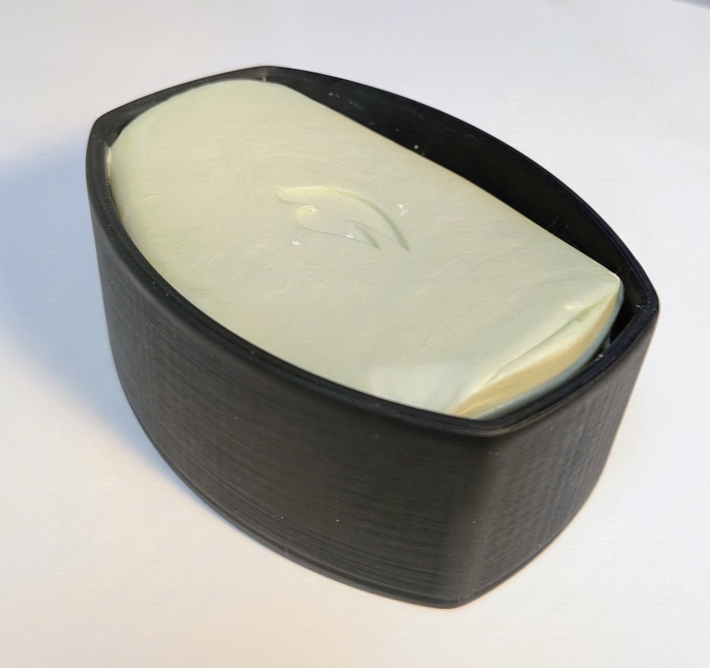

# dove_dish

This repository contains an scad model of a dish that is sized to hold a bar of Dove Men+Care soap.  The dish holds it concave side up (with the Dove logo facing down) so that it can lathered with a shaving brush.  It can be turned into an STL or 3MF file suitable for printing using `openscad`:

    openscad -o dove_dish.stl dove_dish.scad
    openscad -o dove_dish.3mf dove_dish.scad

